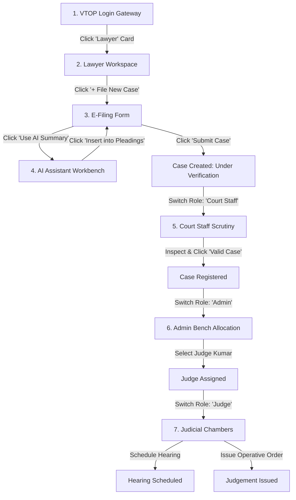

# Assessment 8.2: User Interface Design and Development

**Project Title:** Court Proceedings Management System (CPMS)  
**Selected Module:** Case Management Module  
**Student Name:** Pranayaa C  
**Registration Number:** 24BYB0189  
**Team Members:** Neethisha AB, Madhumitha R  
**Course Code & Title:** BCSE301P – Software Engineering Lab  
**Institution:** School of Computer Science Engineering and Information Systems, Vellore Institute of Technology (VIT)  
**Faculty In-Charge:** Prof. Asha N / Dr. Asha N  
**Date of Submission:** October 2026 / 05.08.2026  

---

## 1. Selected Module

The module selected for design and development is the **Case Management Module**. It is the central nervous system of the Court Proceedings Management System (CPMS), responsible for facilitating and tracking the entire lifecycle of legal disputes from electronic petition filing through registry scrutiny, judge allocation, hearing proceedings, evidence exchange, and final judgment issuance.

---

## 2. Purpose of the Selected Module

Traditional court systems suffer from heavy case backlogs, physical file misplacement, lack of transparency for litigants, and slow asynchronous communication between court members.

The purpose of the CPMS Case Management Module is to:
1. **Digitize Case Ingestion:** Provide an electronic filing (e-filing) portal allowing lawyers to submit structured pleadings, link authenticated clients, and request urgent reliefs.
2. **Standardize Registry Scrutiny:** Establish a formal scrutiny queue for Court Staff to inspect petitions for legal compliance under Civil Procedure Code (CPC) Order VII, enabling transparent admission or defect returns with recorded remarks.
3. **Automate Lifecycle State Progression:** Enforce the authoritative 12-state transition workflow (`Case Filed` -> `Under Verification` -> `Case Registered` -> `Judge Assigned` -> `Hearing Scheduled` -> `Judgement Issued` -> `Case Closed`).
4. **Deliver Complete Judicial Transparency:** Offer litigants, advocates, and presiding judges an instant digital audit trail, hearing calendar, evidence locker, and operative judgment repository.

---

## 3. User Requirements

The module satisfies distinct functional requirements across all five documented roles:

### A. Lawyer Requirements
- **UR_LAW_01:** Select an authenticated client from the court registry.
- **UR_LAW_02:** Submit formal case titles and detailed factual pleadings (minimum 20 characters).
- **UR_LAW_03:** Receive immediate acknowledgment with a unique case tracking number.
- **UR_LAW_04:** View scrutiny defect notices with specific remarks and resubmit corrected pleadings without restarting the filing process.
- **UR_LAW_05:** Upload exhibits and evidence documents linked directly to the matter.

### B. Court Staff Requirements
- **UR_STF_01:** Access a dedicated verification queue filtering newly filed petitions.
- **UR_STF_02:** Inspect petitioner details, jurisdiction, and legal facts.
- **UR_STF_03:** Admit valid cases into the court register (`Case Registered`) or return defective cases with recorded remarks (`Case Rejected`).

### C. Admin Requirements
- **UR_ADM_01:** View all registered cases awaiting judicial assignment.
- **UR_ADM_02:** Inspect roster specialisations of available judges and assign the presiding judge.
- **UR_ADM_03:** Monitor caseload distribution and archive disposed matters (`Case Closed`).

### D. Judge Requirements
- **UR_JDG_01:** View active cases assigned to their bench.
- **UR_JDG_02:** Access submitted pleadings, evidence documents, and hearing transcripts in a unified view.
- **UR_JDG_03:** Schedule and reschedule hearings, record minutes of proceedings, and pronounce operative judgments.

### E. Client (Litigant) Requirements
- **UR_CLI_01:** Track real-time status of their case through an intuitive visual state stepper.
- **UR_CLI_02:** View upcoming court dates, assigned judge details, and download orders.

---

## 4. User Interface Architecture & Screen Design

The user interface follows a modern two-tier structure:
1. **VIT VTOP-Style Multi-Role Gateway Screen:** Dedicated landing portal mirroring the university VTOP system layout with 5 distinct role login cards and Spotlight notice board.
2. **CPMS Case Management Workspace:** Comprehensive dashboard containing metrics cards, search and filter bars, case registry tables, e-filing forms, and an interactive state timeline modal.

### Key Screens & Components:

#### Screen 1: VIT VTOP Multi-Role Login Gateway
- **Header Banner:** Deep blue university gradient (`#103260` to `#1a4fa0`) with VIT crest, campus attribution, and academic project tags.
- **Hero Title:** `CPMS translates to "Court Proceedings Management System"` with a clear explanatory subtitle.
- **5 Distinct Role Login Cards:** Horizontal flex row of cards for **Lawyer**, **Court Staff**, **Admin**, **Judge**, and **Client**.
  - Each card features a top accent border stripe in its distinctive role color:
    - Lawyer: Royal Blue (`#2563eb`)
    - Court Staff: Amber Gold (`#d97706`)
    - Admin: Deep Indigo (`#4338ca`)
    - Judge: Royal Purple (`#7e22ce`)
    - Client: Emerald Green (`#059669`)
  - Each card displays an avatar icon, role name, user persona name, designation/bar ID, and a dedicated square entrance button (`➜`).
  - Clicking any card or its entrance button immediately authenticates that user persona with a smooth ripple animation and opens the CPMS dashboard.
  - A subtle `Credentials` link opens a clean modal for manual email/password entry.
- **Spotlight Section (Left):** Burgundy-header notice box featuring daily cause lists, practice directions, and evidence advisories.
- **App Badges & System Status (Right):** Mobile app links (Google Play / App Store) and real-time database/AI engine status indicators.

#### Screen 2: Case Management Dashboard
- **Top Metrics Row:** 4 summary cards displaying Total Cases, Active Matters, Registry Scrutiny, and Disposed Cases with dynamic counts.
- **Search & Filter Bar:** Full-text instant search input, status dropdown filter (`All Statuses`, `Under Verification`, `Hearing Scheduled`, etc.), and a "+ File New Case" action button.
- **Case Registry Table:** Responsive data table displaying Case ID, Title, Client/Lawyer parties, Filing Date, Presiding Judge, Status Badge, and Action Buttons (`View Details`, `Scrutiny`, `Assign Judge`).

#### Screen 3: Electronic Case Filing Form
- **Client Selection Dropdown:** Populated dynamically from registered litigant records with contact and address details.
- **Case Title Input:** Enforces court naming conventions (`Plaintiff v. Defendant`).
- **Pleadings & Statement of Facts Textarea:** Multi-line textarea with a direct shortcut button: `🤖 Use AI Case Summary Assistant` allowing advocates to summarize dispute narratives and insert them with 1 click.
- **Filing Date Picker:** Defaults to current date with calendar widget.

#### Screen 4: Case Detail & State Timeline Modal
- **Interactive Workflow Stepper:** Visual timeline rendering the 12 UML states with completed, active, and pending indicators.
- **Tabbed Information Pane:** Details, Hearings, Evidence, and Audit Trail tabs.
- **Role-Gated Action Bar:** Contextual action buttons based on active role:
  - *Court Staff:* Approve (`Valid Case`) or Return (`Invalid/Incomplete` with defect remarks).
  - *Admin:* Presiding Judge assignment dropdown.
  - *Judge:* Schedule Hearing, Record Proceedings, Pronounce Judgment.
  - *Lawyer:* Resubmit Pleadings, Upload Evidence.

---

## 5. Demonstration of User Interactions

---

## 6. Adherence to UI Design Principles

### 1. Principle of Simplicity
- **Direct Role Cards:** Rather than forcing users through tedious credential typing, 5 prominent role cards offer instant, one-click access to each persona while keeping the underlying authentication genuine.
- **Minimalist Layout:** The interface avoids visual clutter by presenting essential information upfront and organizing secondary details into clean tabs and modals.
- **Focused Workflows:** Forms contain only necessary legal fields with clear instructional placeholders.

### 2. Principle of Consistency
- **Unified Color Coding:** Status indicators maintain consistent semantics across tables, cards, and state steppers (e.g., Green for Registered/Disposed, Amber for Under Verification, Blue for Hearing Scheduled, Purple for Judge Assigned).
- **Consistent Component Hierarchy:** Panels, headers, modals, and buttons share identical padding, border radii (6px–10px), and elevation shadows.
- **Role Identity Persistence:** The top header consistently displays the active user name, avatar initials, and role badge across all sub-views.

### 3. Principle of Usability
- **Instant Search & Filtering:** The case table responds in real time to search queries and status dropdown filters without full page reloads.
- **Seamless Role Switching:** Users can switch roles effortlessly using either the top-bar pills or the `⮌ VTOP Gateway` return button.
- **Responsive Adaptability:** Layouts adjust smoothly from multi-column desktop displays (1440px) down to single-column tablet and mobile viewports.

### 4. Principle of Feedback
- **Live Toast Notifications:** Every user action (case filing, role switch, verification, evidence upload) triggers an immediate, color-coded toast alert (Success, Info, Error).
- **Visual State Transition Stepper:** The timeline dynamically reflects the current stage of the dispute, giving immediate feedback on what stage has completed and what is pending.
- **Field-Level Validation:** The e-filing form highlights empty required fields and displays validation messages before submission.

---

## 7. How the Interface Supports Module Functionality

The developed interface is tightly bound to the backend data model and business logic:
1. **Prevents Illegal Transitions:** Action buttons are dynamically rendered based on the case's current status and the user's role, mathematically preventing invalid state mutations.
2. **Eliminates Data Duplication:** All five role views operate on the shared SQLite database, guaranteeing that an approval by Court Staff is immediately visible to the Admin, Judge, Lawyer, and Client.
3. **Integrates AI Capabilities:** The AI Case Summary Assistant is embedded directly into the filing workflow, enabling advocates to generate concise legal briefs without leaving the portal.
